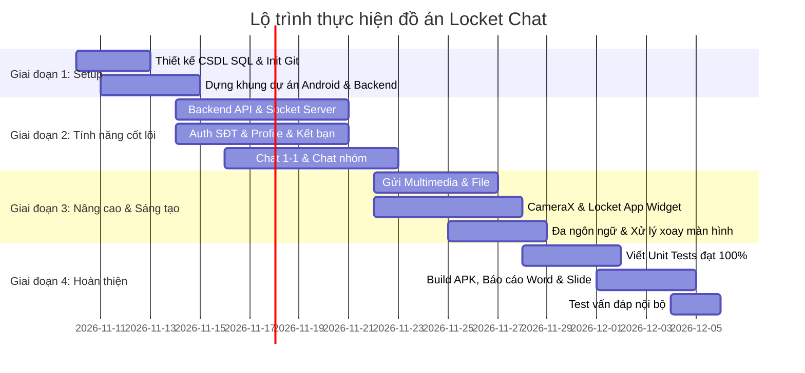

# Kế Hoạch Đồ Án Cuối Kỳ: Ứng Dụng Locket Chat (Android Java + SQL)

> **Môn học:** Lập trình di động Android  
> **Thời lượng đồ án:** 50% điểm tổng kết môn  
> **Kiến trúc:** Android Java (Native) + Backend REST API/Socket.io + Database SQL riêng (MySQL)  
> **Quy mô nhóm:** 4 thành viên  

---

## I. NGUYÊN TẮC BẮT BUỘC (CORE PRINCIPLES)

### 1. Nguyên tắc Liêm chính học thuật & Đánh giá cá nhân (Rubric P0)
* **Quy tắc Git Commit (Hệ số 0.9 - 1.1):**
  * Điểm cá nhân = $\text{Điểm đồ án} \times \text{Hệ số đóng góp}$.
  * Mọi thành viên **bắt buộc** phải tự commit mã nguồn từ tài khoản Git cá nhân của mình trên máy tính của mình. Tuyệt đối không để 1 người gom code rồi commit hộ cả nhóm (thành viên không có commit thực chất sẽ bị 0 điểm).
  * Commit message phải rõ ràng, tuân thủ Conventional Commits (ví dụ: `feat(auth): add phone number validation`, `fix(chat): handle screen rotation crash`).
* **Giải trình mã nguồn khi Vấn đáp (Chiếm 40% điểm):**
  * Theo rubric: *"Thành viên nào merge đoạn mã đó phải giải thích được nó khi vấn đáp. Mã do AI sinh mà không khai báo, hoặc sinh viên không giải thích được, bị xử lý như vi phạm liêm chính học thuật"*.
  * Cả 4 thành viên phải hiểu tường tận từng dòng code trong module mình phụ trách và cách module đó kết nối với hệ thống.

### 2. Nguyên tắc Kỹ thuật & Clean Code (Android Java)
* **Mô hình MVVM (Model - View - ViewModel):**
  * **View (Activity/Fragment):** Chỉ xử lý hiển thị giao diện và nhận tương tác người dùng. Tuyệt đối không viết logic tính toán, gọi mạng hay truy vấn DB trực tiếp trong Activity/Fragment.
  * **ViewModel + LiveData:** Quản lý dữ liệu và trạng thái UI. Đây là chìa khóa để **vượt qua bài kiểm tra xoay màn hình (Orientation Change)** mà không bị mất dữ liệu hay reload API.
  * **Repository:** Đóng vai trò là Single Source of Truth, điều phối dữ liệu giữa Local Cache (Room/SQLite) và Remote API (Retrofit).
* **Quản lý tài nguyên & Đa ngôn ngữ (i18n):**
  * Không hardcode chuỗi ký tự trong layout XML hay file Java. 100% text phải lấy từ `R.string.xxx` (`res/values/strings.xml` cho Tiếng Việt và `res/values-en/strings.xml` cho Tiếng Anh).
* **An toàn dữ liệu & Cấu trúc nộp bài (5 điểm bài nộp):**
  * File nén nộp bài tuyệt đối **không chứa** thư mục `build/`, `.gradle/`, `node_modules/`, file `keystore` hay `keystore.properties`. File `.gitignore` phải cấu hình chuẩn ngay từ ngày đầu.

---

## II. PHÂN CHIA CÔNG VIỆC CHI TIẾT CHO 4 THÀNH VIÊN

### THÀNH VIÊN 1: BACKEND SERVER & DATABASE ARCHITECT (Trưởng nhóm)
> **Mục tiêu:** Cung cấp toàn bộ nền tảng dữ liệu, API và hạ tầng Socket realtime để 3 thành viên mobile tích hợp.

* **Nhiệm vụ 1: Thiết kế & Cài đặt CSDL SQL (MySQL)**
  * Viết script `schema.sql` tạo các bảng: `users`, `friendships`, `conversations`, `conversation_members`, `messages`, `locket_moments`.
  * Đảm bảo ràng buộc toàn vẹn dữ liệu (Primary Key, Foreign Key, Index tìm kiếm theo số điện thoại).
  * Chuẩn bị dữ liệu mẫu (Seed Data) gồm 5-10 tài khoản thử nghiệm.
* **Nhiệm vụ 2: Xây dựng RESTful API (Node.js Express / Java Spring Boot)**
  * Module Auth: Đăng ký, Đăng nhập qua số điện thoại, Xác thực JWT token.
  * Module User & Friendship: Cập nhật profile, Tìm kiếm user theo SĐT, Gửi/Chấp nhận kết bạn.
  * Module Chat & Locket: Tạo nhóm chat, Lấy lịch sử tin nhắn phân trang (Pagination), Upload ảnh/video/file lên thư mục server.
* **Nhiệm vụ 3: Cấu hình Realtime Socket Server**
  * Xây dựng Socket Server (Socket.io hoặc WebSocket native).
  * Lắng nghe sự kiện: `join_room`, `send_message`, `receive_message`, `user_typing`, `new_locket_moment`.
* **Nhiệm vụ 4: Kiểm thử & Tài liệu API**
  * Viết Unit test cho các Controller & Service (đạt độ bao phủ tốt).
  * Xuất bộ tài liệu Postman Collection (kèm file json) để 3 thành viên Android dễ dàng test API.

---

### THÀNH VIÊN 2: ANDROID CORE (Xác thực, Quản lý tài khoản, Kết bạn, Đa ngôn ngữ)
> **Mục tiêu:** Đảm bảo toàn bộ luồng người dùng đầu vào, danh bạ bạn bè, quản lý profile và hoàn thành tiêu chí i18n + xoay màn hình.

* **Nhiệm vụ 1: Quản lý Phiên & Đăng nhập/Đăng ký qua SĐT**
  * Màn hình Splash Screen: Kiểm tra token lưu trong `SharedPreferences` / `EncryptedSharedPreferences` (nếu còn hạn thì vào thẳng App, hết hạn thì về Login).
  * Màn hình Đăng nhập / Đăng ký: Nhập số điện thoại, mật khẩu / mã OTP giả lập.
  * Bắt lỗi dữ liệu nhập (Regex số điện thoại Việt Nam, độ dài mật khẩu).
* **Nhiệm vụ 2: Màn hình Quản lý Tài khoản (Profile Activity)**
  * Hiển thị thông tin cá nhân (Avatar, Tên hiển thị, Số điện thoại, Ngày tham gia).
  * Chức năng đổi ảnh đại diện (chọn ảnh từ thư viện đẩy lên API).
  * Nút Chuyển đổi ngôn ngữ (Tiếng Việt <-> English) ngay trong cài đặt ứng dụng.
* **Nhiệm vụ 3: Tìm kiếm & Thêm người dùng bằng Số điện thoại**
  * Thanh tìm kiếm người dùng theo số điện thoại thời gian thực (`SearchView` / `EditText` với Debounce).
  * Danh sách kết quả tìm kiếm: Hiển thị trạng thái (Chưa kết bạn / Đã gửi lời mời / Đã là bạn bè).
  * Nút "Thêm bạn bè" và màn hình Danh sách bạn thân (Friend List).
* **Nhiệm vụ 4: Đáp ứng Rubric Nâng cao & Unit Test**
  * Tạo đầy đủ bộ từ điển `res/values/strings.xml` (Tiếng Việt) và `res/values-en/strings.xml` (Tiếng Anh).
  * Xử lý vòng đời khi xoay màn hình (Landscape/Portrait) ở các Activity/Fragment mình làm không bị giật, không mất dữ liệu nhập dở.
  * Viết Unit Test: `UserValidatorTest` (kiểm tra định dạng SĐT, mật khẩu), `UserRepositoryTest` (mock API response).

---

### THÀNH VIÊN 3: ANDROID CHAT ENGINE (Chat 1-1, Chat nhóm, Multimedia & Realtime)
> **Mục tiêu:** Hiện thực hóa trái tim của đồ án - Hệ thống nhắn tin thời gian thực 1-1, nhóm và hỗ trợ gửi đa phương tiện.

* **Nhiệm vụ 1: Màn hình Danh sách hội thoại (Recent Chats Fragment)**
  * `RecyclerView` hiển thị danh sách các cuộc trò chuyện gần nhất (Avatar, Tên bạn/nhóm, Tin nhắn cuối cùng, Thời gian, Badge tin chưa đọc).
  * Nút tạo nhóm chat: Cho phép chọn nhiều bạn bè từ danh bạ để tạo phòng chat nhóm và đặt tên nhóm.
* **Nhiệm vụ 2: Màn hình Chi tiết Trò chuyện (Chat Activity 1-1 & Group)**
  * `RecyclerView` hiển thị luồng tin nhắn (Tách rõ `ItemMessageSent` bên phải và `ItemMessageReceived` bên trái).
  * Tích hợp `Socket.io-client` Java: Khi có tin nhắn mới lập tức append vào danh sách và cuộn xuống dưới cùng.
  * Hỗ trợ lưu trữ local (SQLite / Room) để xem lại tin nhắn khi mất mạng (Offline-first).
* **Nhiệm vụ 3: Gửi tin nhắn Đa phương tiện (Multimedia & Files)**
  * Gửi ảnh/video: Mở Intent chọn ảnh từ thư viện, hiển thị thanh tiến trình tải lên, gửi dạng tin nhắn ảnh.
  * Gửi file tài liệu (.pdf, .docx, .zip): Cho phép chọn file từ bộ nhớ máy, hiển thị icon file kèm dung lượng trong bong bóng chat.
  * Ghi âm tin nhắn thoại (Audio Message): Nhấn giữ nút micro để ghi âm (`MediaRecorder`) và gửi file `.mp3`/`.aac`.
* **Nhiệm vụ 4: Xoay màn hình & Unit Test**
  * Đảm bảo khi người dùng xoay ngang màn hình trong lúc đang chat: tin nhắn không bị load lại từ đầu, thanh nhập văn bản giữ nguyên nội dung.
  * Viết Unit Test: `MessageFormatTest` (xử lý định dạng ngày giờ tin nhắn), `ChatViewModelTest`.

---

### THÀNH VIÊN 4: ANDROID LOCKET & CHỨC NĂNG SÁNG TẠO (Camera-first, App Widget, Direct Call)
> **Mục tiêu:** Tạo nên sự khác biệt độc đáo phong cách Locket, ghi trọn **5 điểm Chức năng Sáng tạo** và nâng tầm điểm giao diện.

* **Nhiệm vụ 1: Giao diện Chụp ảnh nhanh Camera-first (Locket Style)**
  * Tích hợp **Android CameraX**: Khởi tạo Camera preview toàn màn hình, nút chụp ảnh hình tròn phong cách Locket, hỗ trợ chuyển đổi Camera trước/sau.
  * Màn hình Preview ảnh sau khi chụp: Thêm ô nhập dòng trạng thái ngắn (Caption), chọn gửi cho "Tất cả bạn thân" hoặc chọn 1 người cụ thể.
* **Nhiệm vụ 2: ⭐ CHỨC NĂNG SÁNG TẠO - Android Home Screen Widget (5 Điểm Rubric)**
  * Xây dựng `AppWidgetProvider` (Locket Widget) để người dùng có thể ghim widget ra màn hình chính điện thoại Android.
  * Khi bạn bè gửi khoảnh khắc mới qua Locket API, Widget tự động nhận dữ liệu hoặc dùng `WorkManager` cập nhật hình ảnh mới nhất ra Widget kèm tên người gửi và caption.
* **Nhiệm vụ 3: Chức năng Sáng tạo phụ - Gọi điện nhanh (Direct Call)**
  * Tích hợp nút gọi điện trong màn hình chi tiết bạn bè: Sử dụng `Intent.ACTION_DIAL` (hoặc `Intent.ACTION_CALL` kèm xin quyền `CALL_PHONE`) để mở trình quay số điện thoại gọi trực tiếp đến số điện thoại của bạn bè.
* **Nhiệm vụ 4: Tối ưu UI/UX & Unit Test**
  * Thiết kế giao diện Touch-first hiện đại (bo góc, viền mềm, dark-theme tương tự Locket xịn).
  * Viết Unit Test: `WidgetUpdateHelperTest`, `ImageCompressorTest` (kiểm tra hàm nén ảnh trước khi tải lên).

---

## III. LỘ TRÌNH THỰC HIỆN (4 GIAI ĐOẠN)

---

## IV. BẢNG CHECKLIST KIỂM THỬ TRƯỚC KHI NỘP BÀI (100 ĐIỂM)

- [ ] **Bài nộp (5đ):**
  - [ ] Thư mục `.git` có đầy đủ commit từ cả 4 tài khoản thành viên.
  - [ ] Đã xóa sạch thư mục `build/`, `.gradle/`, `node_modules/`, không có file keystore.
  - [ ] File APK cài đặt thử nghiệm hoạt động tốt trên máy thật/máy ảo.
  - [ ] Báo cáo Word (.docx) đầy đủ sơ đồ usecase, ERD database, kiến trúc, hình ảnh chức năng.
- [ ] **Chức năng cơ bản (20đ):**
  - [ ] Đăng ký/Đăng nhập bằng số điện thoại.
  - [ ] Tìm kiếm người dùng bằng số điện thoại và kết bạn thành công.
  - [ ] Chat trực tiếp 1-1 hiển thị thời gian thực qua Socket.
  - [ ] Tạo nhóm và chat trong nhóm nhiều thành viên.
  - [ ] Quản lý tài khoản (cập nhật avatar, tên).
- [ ] **Chức năng nâng cao (15đ):**
  - [ ] Đổi ngôn ngữ trong máy hoặc trong app (Tiếng Việt <-> Tiếng Anh) hoạt động chuẩn.
  - [ ] Gửi thành công ảnh, video, audio voice và tệp tài liệu.
  - [ ] Xoay màn hình tại phòng Chat và màn hình chính không bị crash hay mất state.
- [ ] **Chức năng sáng tạo (5đ):**
  - [ ] Widget màn hình chính cập nhật ảnh Locket mới nhất.
  - [ ] Nút gọi điện nhanh qua SĐT bạn bè.
- [ ] **Chất lượng bài tập (15đ):**
  - [ ] Giao diện đồng bộ, sạch sẽ, không lỗi font, không vỡ layout.
  - [ ] Toàn bộ Unit Test chạy xanh (`PASSED`).
- [ ] **Vấn đáp & Demo (40đ):**
  - [ ] Cả 4 thành viên đều nắm rõ luồng dữ liệu của module mình làm và trả lời trôi chảy câu hỏi của giảng viên.
